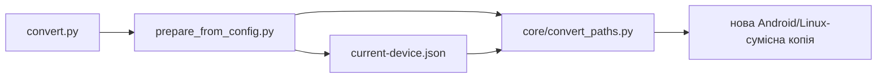
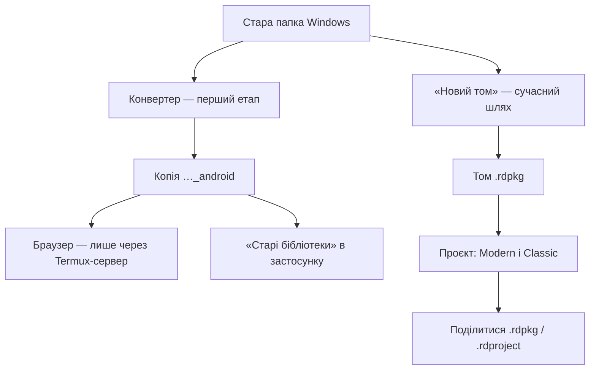

# Конвертер

## Де він знаходиться

Є два рівні:

- `convert.py` — простий запуск із кореня репозиторію;
- `core/convert_paths.py` — справжня логіка конвертації.

Для звичайного використання тобі потрібен саме:

```text
convert.py
```

## Що він робить

За замовчуванням читає:

```text
config/current-device.json
```

Звідти бере:

```text
/storage/emulated/0/Documents/Renault/laguna 2 2001-2006
```

і створює нову виправлену копію:

```text
/storage/emulated/0/Documents/Renault/laguna 2 2001-2006_android
```

Оригінальну папку не змінює.

## Запуск

У корені репозиторію:

```bash
python convert.py
```

## Схема



## Важливо

Це поки не Android-застосунок і не APK. Це робочий конвертер для етапу розробки.

Пізніше ця сама логіка буде викликатися з нашого Android-застосунку через нормальний інтерфейс.


## Modern Runtime IR

Конвертер/packager тепер поступово стає compiler-ом старої Renault документації.

Classic-копія **не видаляється і не переписується як runtime**. Вона залишається робочим compatibility/reference mode.

Паралельно package step генерує:

```text
_renault/runtime-tree.json
```

Це нормалізований JSON-контракт для майбутнього повністю native Modern mode.

Phase 1 містить:
- Classic shell/frame topology;
- named frames;
- список секцій 101/103/105/...;
- назви секцій;
- legacy entrypoint кожної секції;
- явний compiler state для ще не розібраних controls/actions/documents.

Наступні фази будуть компілювати `MENU/*.HTM`, `PC/*.HTM` та legacy JavaScript у наші declarative controls/actions/document routes.

Архітектурний контракт:
`docs/architecture/MODERN_NATIVE_IR_PLAN.md`.


## Історія і місце конвертера (розбір 2026-10-12)

Власник спитав: навіщо був конвертер і копія `…_android`, і чи вона відкривається в браузері.

**Перший етап (Termux + Python).** `convert.py` робив з Windows-папки копію `…_android` з виправленими великими/малими літерами в посиланнях. Відкривав її в браузері **локальний сервер** з Termux-меню (пункт 1 «Відкрити браузерну документацію» → `tools/termux/reno-docs.sh` → `web/serve.py` на `127.0.0.1:8080` + PDF.js, бо Android Chrome не показує PDF усередині сторінки). Тобто «відкривається в браузері» завжди означало «через наш сервер у Termux».

**Чому копія не відкривається в браузері напряму.** Android-браузери не відкривають локальну HTML-папку з фреймами, переходами між сторінками і PDF без сервера: файловий менеджер передає браузеру лише один файл, без сусідніх. Тому без Termux-сервера копія в браузері на телефоні не працює (phone QA 2026-10-12 це підтвердив).

**Другий етап (APK).** Застосунок навчився додавати готову `…_android` папку (кнопка «Legacy») і відкривати її. Потім конвертер перенесли в застосунок (v0.5.37+, «Інструменти → Конвертер»), щоб не потрібен був Termux.

**Сучасний шлях.** «Новий том» бере стару Windows-папку або архів і одразу робить перевірений том `.rdpkg` у проєкті (Modern і Classic), яким можна поділитися (`.rdpkg` / `.rdproject`). Проміжна копія `…_android` для цього не потрібна.



Рішення, що робити з конвертером і «Legacy» (залишити / сховати / прибрати / зробити справжню браузерну версію), — за власником; див. журнал.
