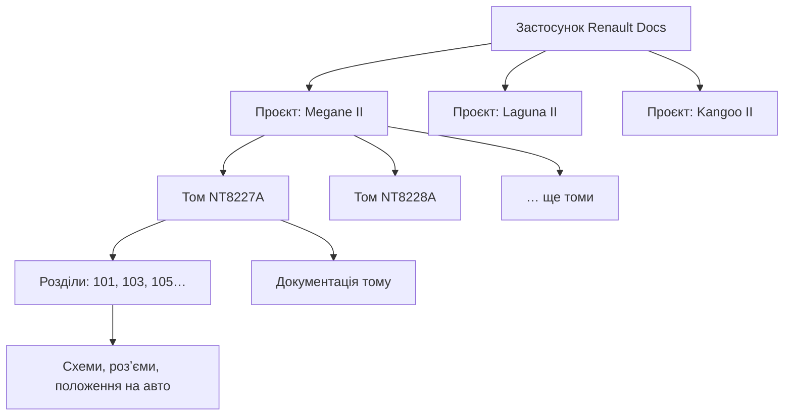
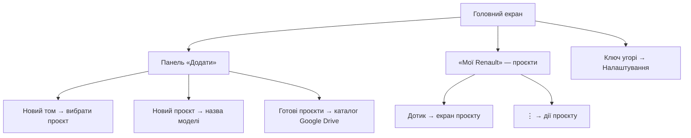
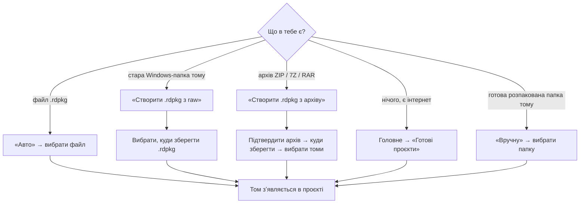
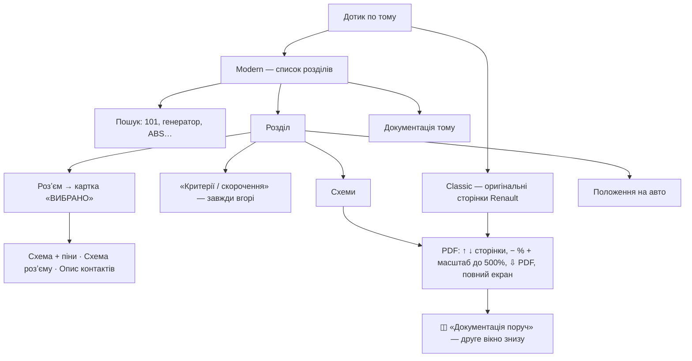
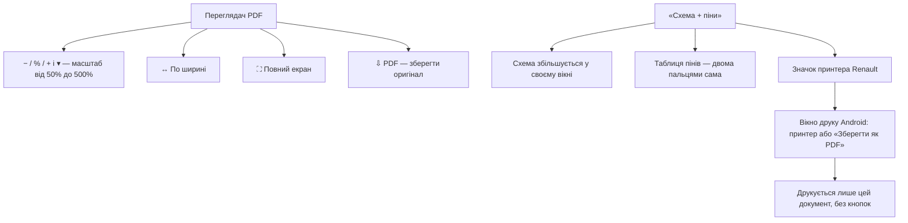
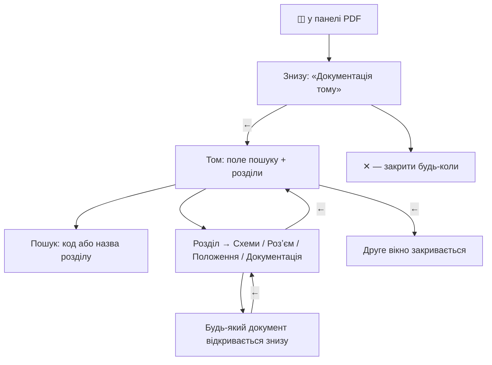
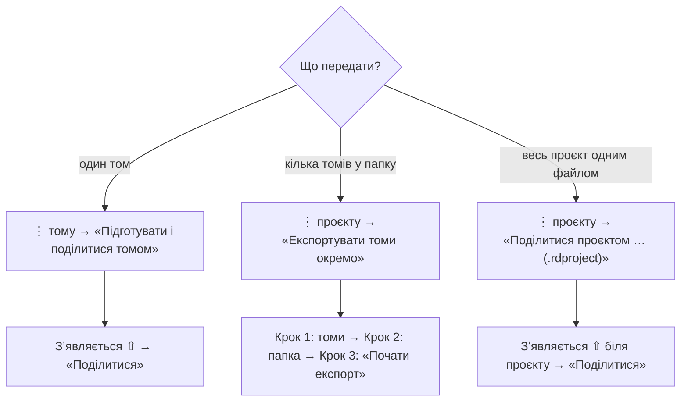
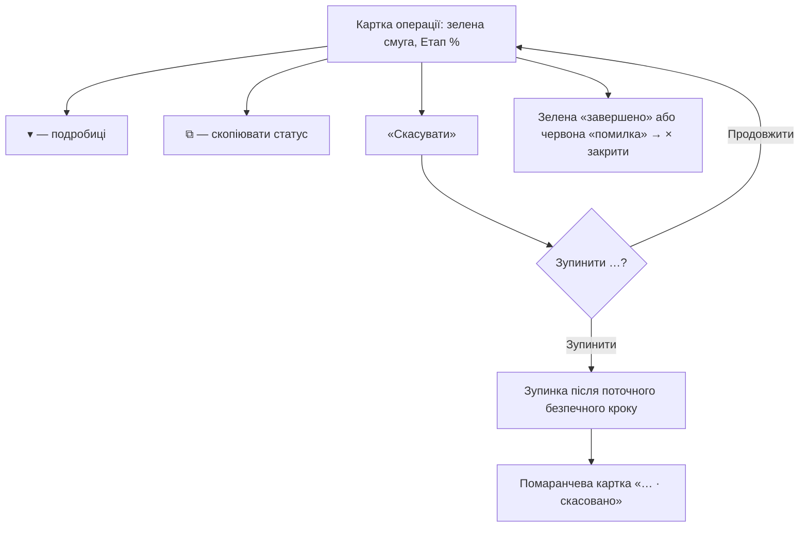

# Посібник Renault Docs

_Для користувача. Версія застосунку v0.5.121, 13.10.2026. Схеми — Mermaid (GitHub показує їх як картинки)._

Цей самий посібник файлами: [Word](Posibnyk-Renault-Docs.docx) · [PDF](Posibnyk-Renault-Docs.pdf). Перезібрати всі формати: `docs/ua/user-guide/build.sh`.

- [Що це за застосунок](#shcho)
- [Головний екран](#holovnyi)
- [Як додати том](#dodaty)
- [Як читати том](#chytaty)
- [PDF, масштаб і друк](#pdf)
- [Друге вікно «Документація поруч»](#poruch)
- [Як поділитися](#podilytysia)
- [Довгі операції і «Скасувати»](#dovhi)
- [Налаштування](#nalashtuvannia)
- [Безпека даних](#bezpeka)

## Що це за застосунок

Renault Docs відкриває на телефоні оригінальну технічну документацію Renault — ту, що колись працювала лише на Windows: розділи ремонту, електросхеми, розʼєми, PDF.

- **Проєкт** — це модель автомобіля: Megane II, Laguna II, Kangoo II.
- **Том** — один випуск документації для цієї моделі, наприклад NT8227A від 2003-01-01. У проєкті може бути багато томів.
- **.rdpkg** — файл одного тому. Його можна створити, отримати від когось або передати іншому.
- **⇧** біля тому чи проєкту — файл уже підготовлений для передачі й лежить усередині застосунку.

## Головний екран

Зверху — панель «Додати». Її можна згорнути кнопкою ▼/▲ і закріпити 📌. Нижче — твої проєкти «Мої Renault». Значок ключа вгорі праворуч відкриває налаштування.

Меню ⋮ проєкту:

- «Експортувати томи окремо (.rdpkg)» — покрокове вікно: томи → папка → почати.
- «Поділитися проєктом одним файлом (.rdproject) · офлайн» — збирає всі томи в один файл і відкриває «Поділитися».
- «Видалити підготовлений .rdproject» — видаляє лише файл ⇧, проєкт лишається.
- «Видалити проєкт» — прибирає проєкт зі списку. Файли на телефоні не видаляються.

## Як додати том

Головне → «Новий том» → вибери проєкт. Відкриється екран проєкту з панеллю «Додати». Далі все залежить від того, що в тебе є:

- Для старої Windows-папки вибирай **саму папку тому** — ту, де INDEX або ACCUEIL лежить прямо всередині. Приклад Kangoo: внутрішня «…NT8486_Visu v5.0_2009.08.31», а не «…(RUS)».
- Архів розпаковувати не треба: застосунок робить це сам у тимчасовому місці. Оригінальний архів не змінюється.
- Якщо такий том уже є, застосунок про це попередить («✓ Уже встановлено», «⚠ Схожий том уже є»).
- Том чужої моделі в цей проєкт без питання не потрапить.

## Як читати том

Дотик по тому відкриває його в режимі, вибраному в налаштуваннях: Modern (стоїть спочатку) або Classic. Перемкнутися можна кнопками Modern / Classic вгорі.

- **Modern** — зручні списки, пошук і таблиці. Таблицю можна зберегти як PDF.
- **Classic** — все як у оригіналі на Windows: ті самі меню, сторінки й переходи.
- Якщо пункт ще не перенесено в Modern, застосунок відкриє його через Classic.
- **Зелена рамка** — де вибираєш зі списку, вибране обведене зеленим: відкрита вкладка, схема, розʼєм, останній розділ. Рамка лишається після «Назад» і повороту екрана, поки працює застосунок.
- **«Критерії / скорочення»** закріплені під меню розділу. Дотик відкриває таблицю скорочень поверх списку; ✕ або «Назад» закривають її, список не зрушує.
- **Картка «ВИБРАНО»** — вибраний розʼєм і його документи («Схема + піни», «Схема розʼєму», «Опис контактів») стоять над списком. «Опис контактів» сам прокручує до таблиці.
- Кнопка «⇩ PDF» зберігає оригінальний PDF у вибрану папку.

## PDF, масштаб і друк

Схеми PDF відкриваються у вбудованому переглядачі. Панель кнопок угорі однакового розміру скрізь: на окремому екрані, у «Схема + піни» і в другому вікні.

- Меню ▾ біля відсотків має кроки аж до 450% і 500%.
- На «Схема + піни» сама сторінка не масштабується — збільшується кожен документ окремо, нижній не зникає.
- Друк — лише через **оригінальний значок принтера** Renault на документі. Окремих кнопок «Друк» застосунок не додає.
- Якщо в документа є друкований варіант (чорно-білий), друкується саме він.

## Друге вікно «Документація поруч»

Кнопка ◫ у панелі PDF відкриває друге вікно знизу. Верхній документ лишається, а знизу можна відкрити будь-який інший документ цього тому — так зверху і знизу стоять два різні документи.

- «←» у другому вікні — крок назад по ланцюжку: документ → розділ → том → закрити.
- Вкладки розділу міняють одна одну, тож «←» з розділу веде одразу в том.
- Таблиці («Опис контактів», «Критерії / скорочення») показуються прямо в другому вікні.
- Останнє відкрите на кожному кроці — у зеленій рамці.
- Межу між вікнами можна посунути.

## Як поділитися

Є три способи — залежно від того, скільки томів потрібно передати.

- **Правило ⇧:** один підготовлений файл на том і на проєкт. Щоб зробити новий — спершу видали старий через ⋮.
- Ще один шлях для одного тому: ⋮ тому → «Експортувати .rdpkg» → вибрати, куди зберегти.
- Однойменні файли в папці не перезаписуються.

> Файл .rdproject поки можна лише відправити. Відкрити його в застосунку на іншому телефоні ще не можна — це в плані. Для передачі краще томи .rdpkg: їх застосунок відкриває через «Авто».

## Довгі операції і «Скасувати»

Підготовка, експорт, імпорт і створення тому йдуть у фоні. Застосунок можна згорнути, прогрес видно у шторці. На екрані — картка з зеленою смугою.

- Скасування прибирає лише недороблений файл цієї операції. Готові томи й оригінали лишаються.
- Останній крок встановлення тому ніколи не переривається, щоб не зламати том.
- Усі вікна-питання переживають поворот екрана.
- «Скасувати» в шторці відкриває застосунок і питає там.

## Налаштування

- «Відкривати dataset» — Modern або Classic за замовчуванням.
- «Масштаб за замовчуванням» — 85%, 100% (за шириною), 120%, 150%, 200%.
- «Крок кнопок − / +» — ±5%, ±10% або ±20%.
- «Папка резервних копій» — поки лише запамʼятовується; резервне копіювання ще не підключене.
- Зміни зберігаються автоматично.

## Безпека даних

- Оригінальні папки, архіви й файли на Google Drive застосунок тільки читає.
- Кожне видалення, скасування, очищення чи скидання спершу питає.
- Видалити проєкт чи том зі списку — не те саме, що видалити файли: файли на телефоні лишаються.
- Недороблені файли пишуться в тимчасове місце й зʼявляються лише цілими.
