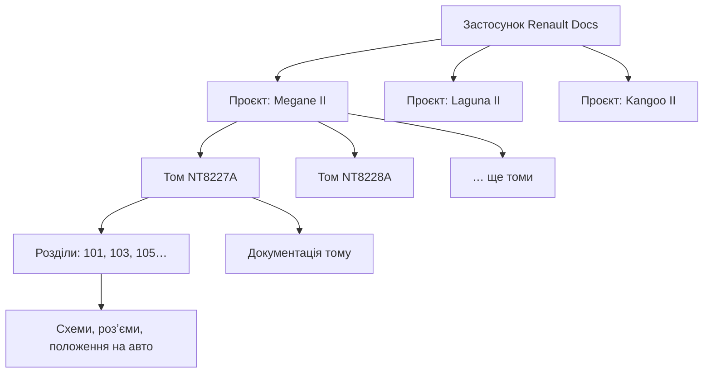
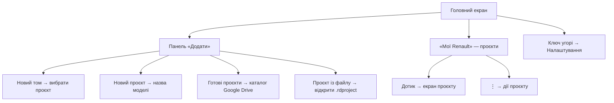
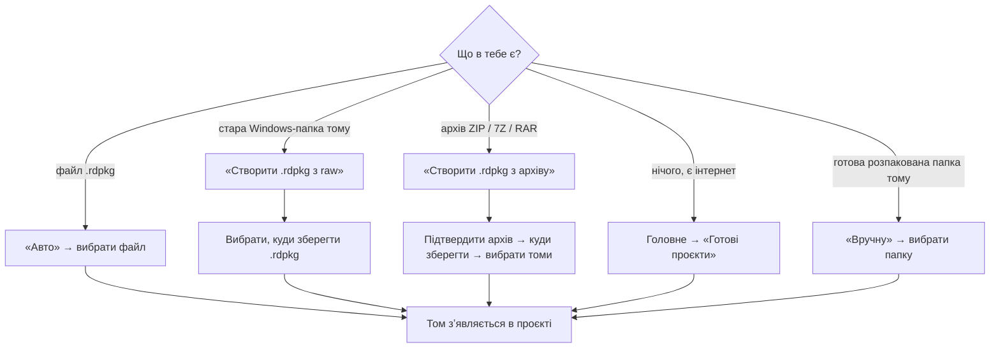
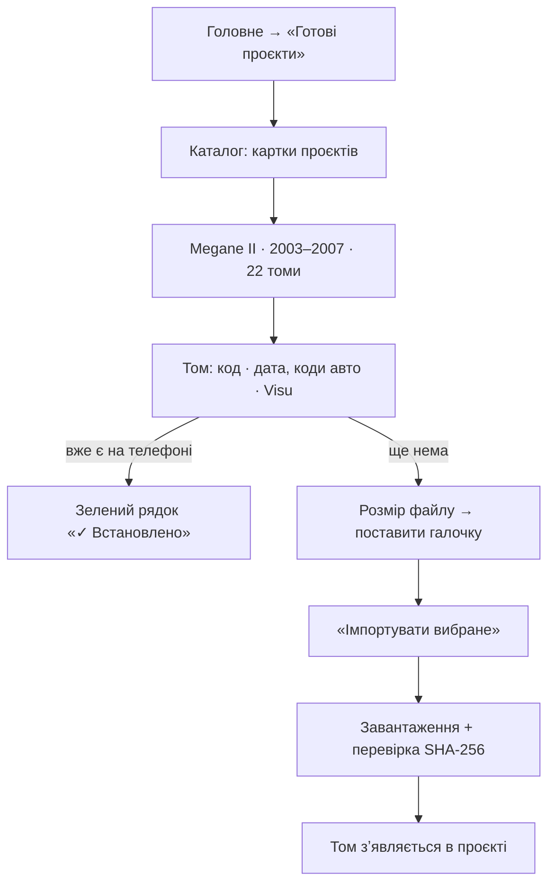
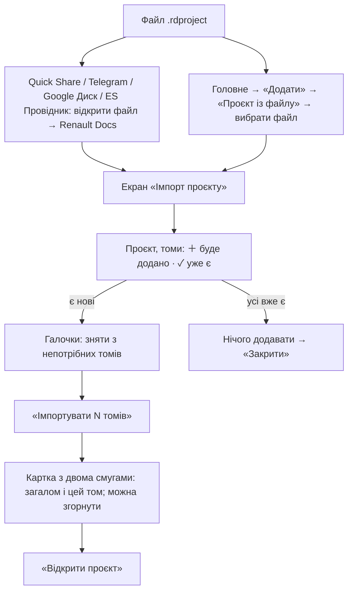
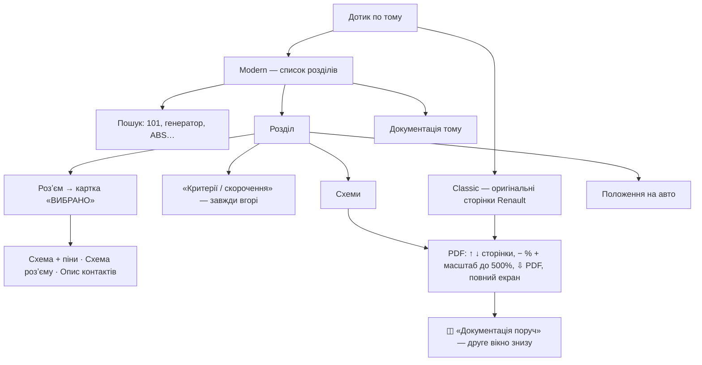
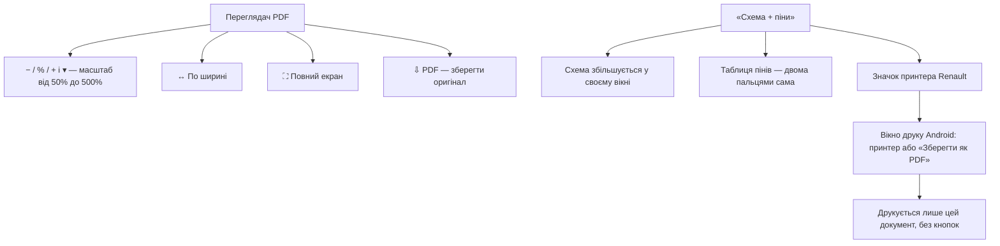
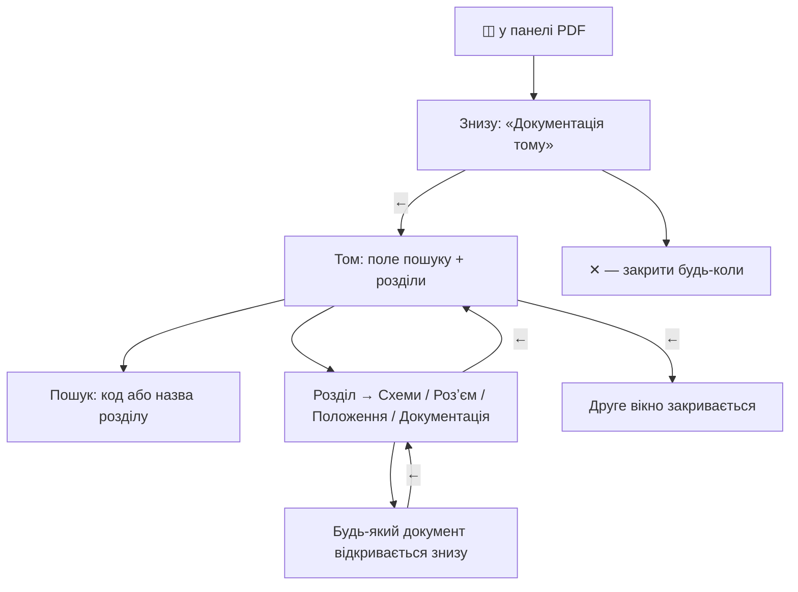
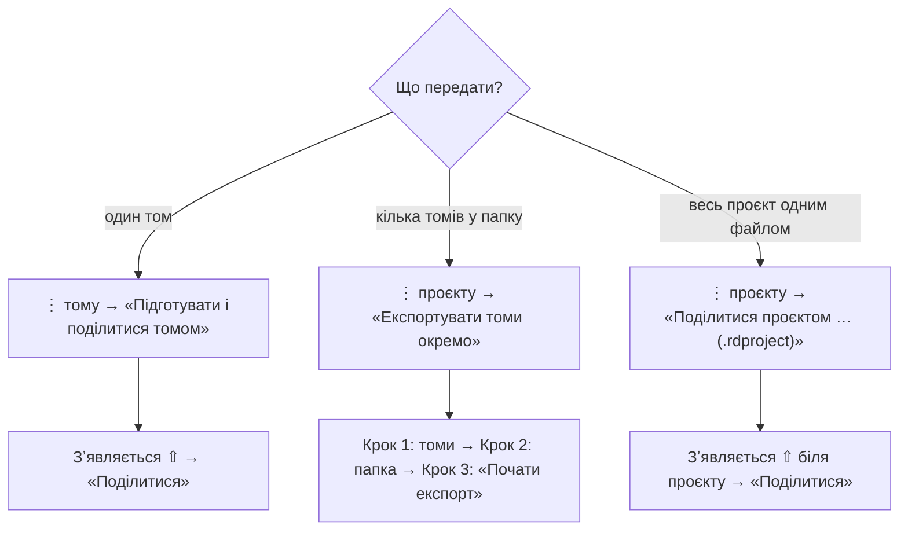
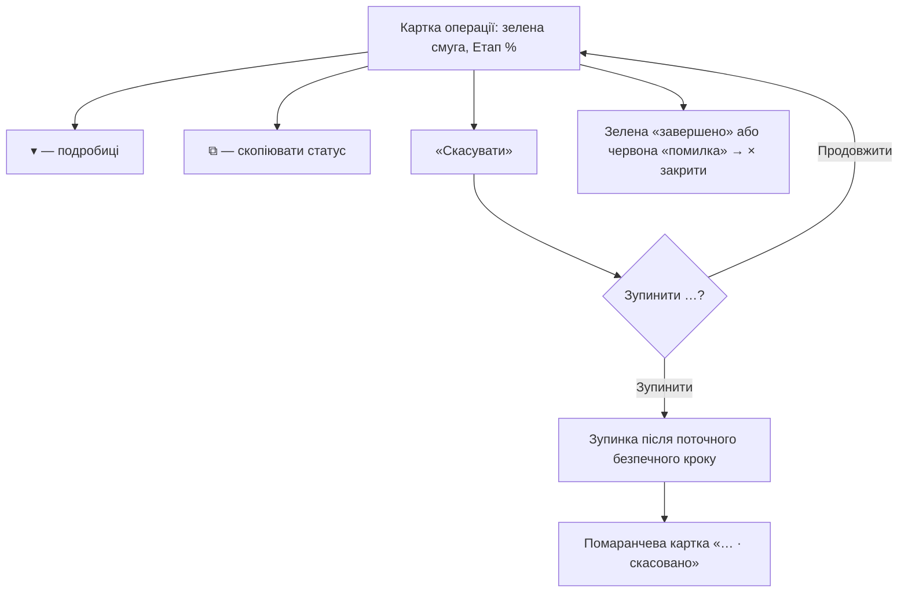

# Посібник Renault Docs

_Для користувача. Посібник для Renault Docs v0.5.141, 17.10.2026. Схеми — Mermaid (GitHub показує їх як картинки)._

Цей самий посібник файлами: [Word](Posibnyk-Renault-Docs.docx) · [PDF](Posibnyk-Renault-Docs.pdf). Перезібрати всі формати: `docs/ua/user-guide/build.sh`.

- [Що це за застосунок](#shcho)
- [Головний екран](#holovnyi)
- [Як додати том](#dodaty)
- [Готові проєкти з Google Диска](#katalog)
- [Проєкт із файлу (.rdproject)](#import)
- [Як читати том](#chytaty)
- [PDF, масштаб і друк](#pdf)
- [Друге вікно «Документація поруч»](#poruch)
- [Як поділитися](#podilytysia)
- [Довгі операції і «Скасувати»](#dovhi)
- [Налаштування](#nalashtuvannia)
- [Безпека даних](#bezpeka)

## Що це за застосунок

Renault Docs відкриває на телефоні оригінальну технічну документацію Renault — ту, що колись працювала лише на Windows: розділи ремонту, електросхеми, розʼєми, PDF.

- **Проєкт** — це модель автомобіля: Megane II, Laguna II, Kangoo II.
- **Том** — один випуск документації для цієї моделі, наприклад NT8227A від 2003-01-01. У проєкті може бути багато томів.
- **.rdpkg** — файл одного тому. Його можна створити, отримати від когось або передати іншому.
- **.rdproject** — весь проєкт одним файлом: усі томи разом. Його можна передати на інший телефон і там відкрити.
- **⇧** біля тому чи проєкту — файл уже підготовлений для передачі й лежить усередині застосунку.

## Головний екран

Зверху — панель «Додати». Її можна згорнути кнопкою ▼/▲ і закріпити 📌. Нижче — твої проєкти «Мої Renault». Значок ключа вгорі праворуч відкриває налаштування.

Меню ⋮ проєкту:

- «Експортувати томи окремо (.rdpkg)» — покрокове вікно: томи → папка → почати.
- «Поділитися проєктом одним файлом (.rdproject) · офлайн» — збирає всі томи в один файл і відкриває «Поділитися».
- «Видалити підготовлений .rdproject» — видаляє лише файл ⇧, проєкт лишається. Додавання чи видалення тому підготовлений файл не прибирає — меню лише підкаже, що він зроблений для старого набору томів.
- «Видалити проєкт» — прибирає проєкт зі списку. Файли на телефоні не видаляються.

## Як додати том

Головне → «Новий том» → вибери проєкт. Відкриється екран проєкту з панеллю «Додати». Далі все залежить від того, що в тебе є:

- Для старої Windows-папки вибирай **саму папку тому** — ту, де INDEX або ACCUEIL лежить прямо всередині. Приклад Kangoo: внутрішня «…NT8486_Visu v5.0_2009.08.31», а не «…(RUS)».
- Архів розпаковувати не треба: застосунок робить це сам у тимчасовому місці. Оригінальний архів не змінюється.
- Якщо такий том уже є, застосунок про це попередить («✓ Уже встановлено», «⚠ Схожий том уже є»).
- Том чужої моделі в цей проєкт без питання не потрапить.
- **Куди лягає том** — у телефон або на карту пам'яті: Налаштування → «Де зберігати нові томи». Том на карті підписаний «▣ на карті пам'яті».

## Готові проєкти з Google Диска

Головне → «Готові проєкти» відкриває каталог Renault Docs з Google Диска (потрібен інтернет). Угорі видно версію каталогу, нижче — картки проєктів: роки документації і скільки томів.

- Кожен том — окремий файл: бери лише ті, що потрібні, а не всі одразу.
- **«✓ Встановлено»** — зелений рядок під томом, який уже є на телефоні. Його качати не треба.
- Після завантаження застосунок звіряє контрольну суму SHA-256. Пошкоджений файл не встановиться.
- Томи великі — від 30 до 240 МБ. Краще качати через Wi-Fi.

## Проєкт із файлу (.rdproject)

Файл .rdproject робить ⋮ проєкту → «Поділитися проєктом одним файлом». На іншому телефоні його можна відкрити — застосунок додасть лише ті томи, яких там ще немає.

- Спершу застосунок лише читає початок файлу і показує, що в ньому є. Нічого не пише, доки не натиснеш «Імпортувати».
- **Куди**: телефон або карта пам'яті — кнопка «Зберегти на карту пам'яті» / «Зберегти в телефон» (те саме, що в Налаштуваннях). Вільне місце рахується там, куди вибрано.
- **Галочки** біля нових томів: усі відмічені, зніми з тих, що не потрібні («Зняти всі галочки» — і познач лише свої). Кнопка рахує вибрані, місце теж рахується для них.
- **✓ Уже є** — такий том уже на телефоні. Його пропускають і не замінюють. Однакові лише за схожою назвою коди (NT8340A і NT8342A) — різні томи.
- Якщо проєкту з такою моделлю ще немає — він створюється, коли встановиться перший том.
- Видно, скільки вільного місця і скільки приблизно треба. Якщо місце закінчується, імпорт сам зупиняється; уже додані томи лишаються.
- Під час імпорту дві смуги. Верхня — **«Загалом: томів 17 з 18 · 96 %»**: готові томи плюс частина поточного, лише вперед. Нижня — **«Цей том: NT8494 — 31 %»**: лише поточний том, на кожному новому томі починається з нуля. Поки том копіюється з файлу, нижня смуга біжить без відсотків.
- Можна натиснути «Скасувати» — на картці або в шторці (шторка відкриває застосунок і питає «Зупинити імпорт проєкту?»). Поточний том не додасться, попередні лишаться. Наступний імпорт того самого файлу продовжить з того, чого бракує.
- Якщо том уже лежить на телефоні чи карті, але його не видно в проєкті (імпорт колись обірвався в останню мить), повторний імпорт не розпаковує його вдруге, а повертає до проєкту: «Повернуто до проєкту … томів, що вже лежали на телефоні / карті».
- На карті пам'яті папка томів позначена файлом .nomedia: Галерея і служба медіа їх не індексують.
- Якщо телефон перезавантажився або Android зупинив застосунок посеред імпорту, екран скаже «Імпорт обірвався» і скільки томів уже додано. Відкрий той самий файл ще раз — додадуться лише томи, яких бракує.
- **«Мої файли» Samsung** не показує Renault Docs у «Відкрити за допомогою»: він не передає ні імені, ні типу файлу. Звідти — Головне → «Додати» → «Проєкт із файлу» (або ES Провідник).
- Якщо Android не дав прочитати файл — на екрані буде кнопка «Вибрати цей файл ще раз»: вибери той самий файл у списку, далі все як звичайно.
- Сам файл .rdproject не змінюється і не видаляється.

## Як читати том

Дотик по тому відкриває його в режимі, вибраному в налаштуваннях: Modern (стоїть спочатку) або Classic. Перемкнутися можна кнопками Modern / Classic вгорі.

- **Modern** — зручні списки, пошук і таблиці. Таблицю можна зберегти як PDF.
- **Classic** — все як у оригіналі на Windows: ті самі меню, сторінки й переходи.
- Якщо пункт ще не перенесено в Modern, застосунок відкриє його через Classic.
- **Зелена рамка** — де вибираєш зі списку, вибране обведене зеленим: відкрита вкладка, схема, розʼєм, останній розділ. Рамка лишається після «Назад» і повороту екрана, поки працює застосунок.
- **«Критерії / скорочення»** закріплені під меню розділу. Дотик відкриває таблицю скорочень поверх списку; ✕ або «Назад» закривають її, список не зрушує.
- **Картка «ВИБРАНО»** — вибраний розʼєм і його документи («Схема + піни», «Схема розʼєму», «Опис контактів») стоять над списком. «Опис контактів» сам прокручує до таблиці.
- Кнопка «⇩ PDF» зберігає оригінальний PDF у вибрану папку.
- **Архів тому** (з v0.5.141): ⋮ тому → «Зробити архів тому» пакує том в один файл .rdpkg поруч (там само — у телефоні чи на карті) і перевіряє кожен файл. Після цього том читається з цього одного файлу. Папка тому лишається як була — нічого не видаляється.
- У тому ж меню: «Читається з архіву ✓» і перемикач «Читати з папки» / «Читати з архіву». Якщо том встановили заново — «Архів тому застарів — зробити заново».
- PDF з архіву перший раз відкривається трохи довше: його копія кладеться в пам'ять телефона (до ~300 МБ, не на карту), далі — одразу. Звільняє ту саму «Очистити кеш».

## PDF, масштаб і друк

Схеми PDF відкриваються у вбудованому переглядачі. Панель кнопок угорі однакового розміру скрізь: на окремому екрані, у «Схема + піни» і в другому вікні.

- Меню ▾ біля відсотків має кроки аж до 450% і 500%.
- На «Схема + піни» сама сторінка не масштабується — збільшується кожен документ окремо, нижній не зникає.
- Друк — лише через **оригінальний значок принтера** Renault на документі. Окремих кнопок «Друк» застосунок не додає.
- Якщо в документа є друкований варіант (чорно-білий), друкується саме він.
- Сторінки, які вже відкривав, застосунок пам'ятає (до ~200 МБ у пам'яті телефона, не на карті) — вдруге схема з'являється одразу, навіть після перезапуску. Цю пам'ять звільняє Android: Налаштування → Програми → Renault Docs → Пам'ять → «Очистити кеш» (томи й проєкти не зникають).

## Друге вікно «Документація поруч»

Кнопка ◫ у панелі PDF відкриває друге вікно знизу. Верхній документ лишається, а знизу можна відкрити будь-який інший документ цього тому — так зверху і знизу стоять два різні документи.

- «←» у другому вікні — крок назад по ланцюжку: документ → розділ → том → закрити.
- Вкладки розділу міняють одна одну, тож «←» з розділу веде одразу в том.
- Таблиці («Опис контактів», «Критерії / скорочення») показуються прямо в другому вікні.
- Останнє відкрите на кожному кроці — у зеленій рамці.
- Межу між вікнами можна посунути.

## Як поділитися

Є три способи — залежно від того, скільки томів потрібно передати.

- **Правило ⇧:** один підготовлений файл на том і на проєкт. Щоб зробити новий — спершу видали старий через ⋮.
- Ще один шлях для одного тому: ⋮ тому → «Експортувати .rdpkg» → вибрати, куди зберегти.
- Однойменні файли в папці не перезаписуються. Файл, який уже лежить у папці, застосунок звіряє за SHA-256: якщо збігся — пише «уже був», не копіює вдруге.
- **«Вибрати лише нові для каталогу»** у кроці 1 сам ставить галочки на томи, яких ще нема в «Готові проєкти».
- На кроках 2 і 3 видно назву вибраної папки. У кінці в папку пишеться короткий JSON-звіт — навіть якщо щось не вдалося.

> Порада: експортуй томи в папку на телефоні, а на Google Диск вивантаж їх кнопкою «+» у застосунку Диск. Якщо одразу вибрати папку Диска, файли бере застосунок Диск і вивантажує сам — великі томи можуть годинами висіти в його черзі.

> Отриманий .rdproject відкривається на іншому телефоні: див. розділ «Проєкт із файлу (.rdproject)». Окремі томи .rdpkg застосунок відкриває через «Авто» на екрані проєкту.

## Довгі операції і «Скасувати»

Підготовка, експорт, імпорт і створення тому йдуть у фоні. Застосунок можна згорнути, прогрес видно у шторці. На екрані — картка з зеленою смугою.

- Скасування прибирає лише недороблений файл цієї операції. Готові томи й оригінали лишаються.
- Останній крок встановлення тому ніколи не переривається, щоб не зламати том.
- Усі вікна-питання переживають поворот екрана.
- «Скасувати» в шторці відкриває застосунок і питає там (для імпорту проєкту — з v0.5.137).
- Коли операція завершилась або сталася помилка — шторка подає звук. Прогрес і «скасовано» — тихо.

## Налаштування

- «Відкривати dataset» — Modern або Classic за замовчуванням.
- «Масштаб за замовчуванням» — 85%, 100% (за шириною), 120%, 150%, 200%.
- «Крок кнопок − / +» — ±5%, ±10% або ±20%.
- **«Де зберігати нові томи»** — «Телефон» або «Карта пам'яті», з вільним місцем. Карта видна, лише коли вставлена. Діє для всіх нових томів; томи, що вже є, лишаються там, де лежать. Оновлений том (той самий, новіша копія) лягає туди, що вибрано зараз.
- Якщо витягти карту, томи з неї підписані «карту не вставлено» і не відкриваються, доки карту не вставиш назад. Нічого не видаляється.
- «Папка резервних копій» — поки лише запамʼятовується; резервне копіювання ще не підключене.
- Зміни зберігаються автоматично.
- «Про програму» → «Інструкція користувача» — ця інструкція всередині застосунку, працює без інтернету.

## Безпека даних

- Оригінальні папки, архіви й файли на Google Drive застосунок тільки читає.
- Кожне видалення, скасування, очищення чи скидання спершу питає.
- Видалити проєкт чи том зі списку — не те саме, що видалити файли: файли на телефоні лишаються.
- Недороблені файли пишуться в тимчасове місце й зʼявляються лише цілими.
